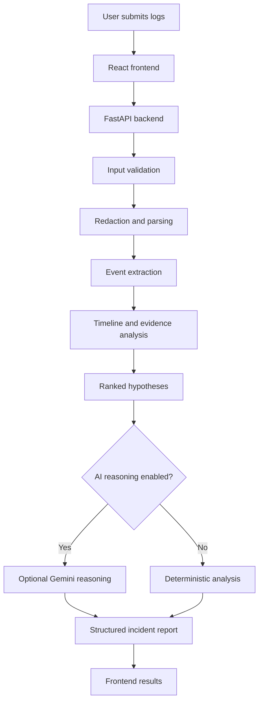

# Whyrus — Evidence-Grounded Incident Analysis

**Understand the failure. Find the reason.**

Whyrus is an incident analysis tool that helps developers investigate application logs, identify likely failure causes, understand incident timelines, and determine what to verify next.

It combines deterministic log parsing and evidence-based analysis with optional AI-assisted reasoning. Its goal is to make incident investigation more structured, explainable, and actionable.

## Overview

When an application fails, its logs may contain thousands of lines, repeated stack traces, warnings, and unrelated events. Finding the underlying cause can take significant time.

Whyrus helps organize this information into a structured incident report containing:

- A summary of the incident.
- Parsed errors and relevant log events.
- A chronological incident timeline.
- Ranked root-cause hypotheses.
- Supporting evidence and confidence indicators.
- Recommended investigation and verification steps.
- Optional correlation with a Git diff.
- Actionable recommendations and a report that can be reviewed or shared.

**Important:** Whyrus generates evidence-based hypotheses, not guaranteed diagnoses. Findings should be verified against the actual application, infrastructure, and operational data.

## Key Features

### 1. Log Analysis

- Accepts application logs for incident investigation.
- Extracts timestamps, severity levels, messages, and relevant events where available.
- Identifies exceptions and stack traces.
- Groups related information to make investigations easier to follow.
- Helps distinguish errors from warnings and informational messages.

### 2. Incident Timeline

Organizes relevant events chronologically to help investigators understand what happened before, during, and after a failure.

### 3. Root-Cause Hypotheses

Ranks possible explanations using available log evidence and deterministic analysis rules.

Each hypothesis should be treated as a candidate explanation rather than a confirmed root cause.

### 4. Evidence and Verification Guidance

Connects proposed explanations to supporting evidence and suggests checks that can help confirm or reject each hypothesis.

### 5. Sensitive Data Redaction

Provides redaction functionality to help prevent secrets and sensitive values from appearing in analysis output.

Redaction is a safeguard, not a guarantee that every sensitive value will be detected. Review data before sharing it.

### 6. Git Diff Correlation

Supports analysis of a supplied Git diff alongside incident logs, helping investigators examine whether recent code changes could be relevant.

A correlation does not establish that a code change caused the incident.

### 7. Optional AI-Assisted Reasoning

Whyrus supports optional Gemini-based reasoning when the relevant API key and dependencies are configured.

When AI is unavailable, the deterministic analysis engine can still provide results where supported.

AI-generated explanations may be incorrect and should be checked against the available evidence.

### 8. Recommendations and Reports

Presents investigation guidance and a structured incident report to support debugging and incident review.

### 9. Presets and Redaction Preview

Includes API functionality for retrieving analysis presets and previewing how sensitive information may be redacted before analysis.

## Architecture



The exact processing path depends on the input, available configuration, and enabled features.

## Technology Stack

### Frontend

- React
- Vite
- Tailwind CSS
- Lucide React icons

### Backend

- Python
- FastAPI
- Uvicorn
- Pydantic

### Optional AI Integration

- Google Gen AI SDK
- Gemini model configured by the application

The deterministic analysis engine does not require a Gemini API key to provide its supported baseline analysis.

## Project Structure

The main project areas are organized as follows. The precise file layout may vary as the project evolves.

```text
whyrus/
├── backend/
│   ├── analyzer/
│   │   ├── parser.py
│   │   └── ...
│   ├── tests/
│   │   └── test_analyzer.py
│   ├── main.py
│   ├── requirements.txt
│   └── ...
├── frontend/
│   ├── src/
│   │   └── services/
│   │       └── api.js
│   ├── vite.config.js
│   ├── package.json
│   └── ...
├── .gitignore
└── README.md
```

## Getting Started

### Prerequisites

Install the following tools:

- Python 3.10 or later, compatible with the project's dependencies.
- Node.js and npm.
- Git.

If you want to use AI-assisted reasoning, you will also need a Gemini API key.

### 1. Clone the Repository

```bash
git clone https://github.com/bhavya-cse/whyrus.git
cd whyrus
```

### 2. Set Up the Backend

Open a terminal in the project directory:

```bash
cd backend
python3 -m venv .venv
source .venv/bin/activate
python -m pip install --upgrade pip
pip install -r requirements.txt
```

On Windows, activate the virtual environment with:

```powershell
.venv\Scripts\Activate.ps1
```

### 3. Configure Environment Variables

From the `backend` directory, create your local environment file if `.env.example` exists:

```bash
cp .env.example .env
```

Open `backend/.env` and configure the variables supported by your backend.

For example:

```dotenv
GEMINI_API_KEY=
PORT=8000
HOST=127.0.0.1
ALLOWED_ORIGINS=http://localhost:5173,http://127.0.0.1:5173
```

- Leave `GEMINI_API_KEY` empty to use deterministic analysis without Gemini, if supported by your current configuration.
- Add your own Gemini API key if you want to enable AI-assisted reasoning.
- Never commit your real `.env` file or API keys to GitHub.
- Use the variable names expected by your actual backend configuration. If the project does not read a particular variable, adding it to `.env` alone will not configure that setting.

Return to the project root before starting the frontend:

```bash
cd ..
```

### 4. Start the Backend

Open a terminal in the `backend` directory and activate its virtual environment:

```bash
cd /Users/apple/Downloads/whyrus/backend
source .venv/bin/activate
uvicorn main:app --reload --host 127.0.0.1 --port 8000
```

If you cloned the project into another location, replace the example path with your actual project path.

The backend should now be available at:

- API base: `http://127.0.0.1:8000`
- Health endpoint: `http://127.0.0.1:8000/api/health`
- Interactive API documentation, if enabled: `http://127.0.0.1:8000/docs`

Keep this terminal open while using the application.

### 5. Start the Frontend

Open a second terminal:

```bash
cd /Users/apple/Downloads/whyrus/frontend
npm install
npm run dev
```

If your project is stored elsewhere, update the path accordingly.

Open the local URL printed by Vite. With the default configuration, it should be:

`http://localhost:5173`

The Vite development server proxies `/api` requests to the backend at `http://127.0.0.1:8000`.

Keep both backend and frontend terminals running.

## API Endpoints

The application provides the following API routes:

| Endpoint | Method | Purpose |
|---|---|---|
| `/api/health` | GET | Check backend health and configuration status |
| `/api/presets` | GET | Retrieve available analysis presets |
| `/api/redact-preview` | POST | Preview sensitive-data redaction |
| `/api/analyze` | POST | Analyze incident logs and return a structured report |

Request fields and response formats should be checked against the current FastAPI implementation and its API documentation.

## Testing

### Run Backend Tests

Activate the backend virtual environment:

```bash
cd /Users/apple/Downloads/whyrus/backend
source .venv/bin/activate
python -m unittest discover -s tests -v
```

This command discovers and runs the tests in the backend's `tests` directory.

### Check Backend Health

With the backend running, execute:

```bash
curl http://127.0.0.1:8000/api/health
```

A healthy response should contain a status indicating that the service is running.

### Check Through the Frontend Proxy

With both servers running, execute:

```bash
curl http://localhost:5173/api/health
```

This checks whether the Vite development server can forward API requests to the backend.

If this request fails, check that:

1. The backend is running on port `8000`.
2. The Vite proxy points to `http://127.0.0.1:8000`.
3. Both processes are running without startup errors.
4. The browser is using `http://localhost:5173`.

## Security and Privacy

Incident logs can contain sensitive operational information. Follow these precautions:

- Never upload production secrets, passwords, access tokens, or private keys unnecessarily.
- Review redaction output before sharing logs or reports.
- Keep `.env` files and API credentials out of version control.
- Restrict access to incident reports containing internal system details.
- Avoid sending confidential logs to external AI services unless your organization's policies permit it.
- Validate and sanitize all user-provided inputs.
- Use appropriate authentication, authorization, and network restrictions before deploying the application publicly.

Redaction can miss unfamiliar secret formats. It should not be treated as a complete security boundary.

## Limitations

- Log analysis depends on the quality, completeness, and format of the supplied data.
- Missing timestamps or inconsistent log formats can affect event ordering.
- A ranked hypothesis is not proof of causation.
- Similar symptoms may have several possible causes.
- Git diff correlation indicates a possible relationship, not definitive causation.
- AI-generated reasoning can be inaccurate or incomplete.
- Redaction may not catch every sensitive value.
- Results should be validated using monitoring data, traces, metrics, code, and infrastructure state where available.

## Future Improvements

Potential areas for further development include:

- Additional log formats and language-specific parsing.
- Better correlation across services and distributed traces.
- More detailed evidence-to-hypothesis explanations.
- Improved detection of recurring incidents.
- Expanded regression and integration tests.
- Exportable reports and incident-history management.
- Authentication and role-based access for team deployments.

These are potential enhancements, not necessarily features currently implemented.

## Contributing

Contributions, bug reports, and suggestions are welcome.

1. Fork the repository.
2. Create a feature branch.
3. Make a focused change.
4. Add or update tests where appropriate.
5. Submit a pull request describing the change and how it was tested.

## License

Check the repository for a `LICENSE` file before redistributing or reusing this project. If no license is present, do not assume that the code is open-source licensed.

---

**Whyrus — Understand the failure. Find the reason.**
