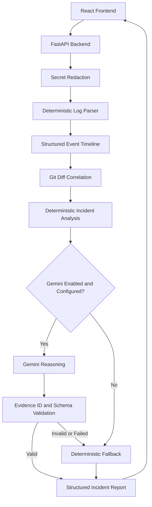

# Whyrus — Evidence-Grounded Incident Analysis

**Understand the failure. Find the reason.**

Whyrus is an incident investigation platform that transforms application logs, stack traces, and recent Git diffs into structured incident timelines, ranked root-cause hypotheses, and actionable debugging recommendations.

It combines deterministic log analysis with optional Google Gemini reasoning to help developers investigate failures systematically, trace hypotheses back to supporting evidence, and identify the telemetry needed to validate a suspected cause.

## Overview

Debugging production incidents often requires correlating scattered log messages, service failures, stack traces, and recent code changes. Whyrus brings these signals into a single investigation workflow.

The platform provides a structured incident report rather than treating an AI-generated explanation as a definitive diagnosis.

### Key Features

- **Log ingestion:** Paste application logs, stack traces, and console output, or upload `.log` and `.txt` files.
- **Secret redaction:** Detect and mask supported secret patterns before incident analysis, with a separate redaction preview.
- **Event timeline:** Parse logs into structured events with timestamps, severity levels, components, and evidence IDs.
- **Error filtering:** Switch between the complete event timeline and error events.
- **Root-cause hypotheses:** Generate ranked, evidence-linked explanations with confidence labels, supporting evidence, and ranking rationale.
- **Verification guidance:** Identify checks developers can perform and missing telemetry needed to investigate hypotheses.
- **Git-diff correlation:** Examine recent code changes as potentially relevant context, not proof of causation.
- **Optional Gemini reasoning:** Enrich deterministic analysis with structured reasoning from Google Gemini when configured.
- **Deterministic fallback:** Continue using rule-based results when Gemini is unavailable or its response fails validation.
- **Prioritized recommendations:** Present suggested debugging steps and relevant files or endpoints.
- **Incident reports:** View incident severity, summary, affected components, event counts, engine status, and parsing warnings.
- **Export-friendly summary:** Copy a concise incident report to the clipboard.
- **Demo presets:** Explore sample database connection, memory exhaustion, and authentication-token incidents.

## How It Works

1. **Submit incident data.** Paste logs or upload a supported file. Optionally provide service context and a unified Git diff.
2. **Redact recognized secrets.** The backend sanitizes supported secret patterns in the submitted logs, Git diff, and service context.
3. **Parse the timeline.** The deterministic parser converts log input into structured events and reports parsing warnings.
4. **Correlate code changes.** When a Git diff is supplied, Whyrus identifies potentially relevant changes.
5. **Generate initial analysis.** The deterministic engine creates an incident overview, hypotheses, and recommended actions.
6. **Optionally enrich the analysis.** Gemini can refine hypotheses and recommendations, subject to evidence-ID and schema validation.
7. **Review the findings.** Inspect the timeline, compare hypotheses, highlight supporting evidence, and follow the suggested verification steps.

## Architecture



### Technology Stack

**Frontend**
- React 19
- Vite 6
- Tailwind CSS v4
- Lucide React
- JavaScript and CSS

**Backend**
- Python
- FastAPI
- Uvicorn
- Pydantic v2
- python-dotenv
- Google Gen AI SDK
- Requests
- python-multipart

**AI and analysis**
- Deterministic log parsing and incident-ranking logic
- Optional Google Gemini `gemini-2.5-flash` integration
- Evidence-ID filtering and Pydantic schema validation
- Rule-based fallback when AI reasoning is unavailable

## Project Structure

```text
whyrus/
├── backend/
│   ├── analyzer/
│   │   ├── ai_engine.py
│   │   ├── git_diff.py
│   │   ├── parser.py
│   │   ├── ranker.py
│   │   └── redactor.py
│   ├── models/
│   │   └── schemas.py
│   ├── tests/
│   │   ├── test_analyzer.py
│   │   └── test_api.py
│   ├── .env.example
│   ├── main.py
│   └── requirements.txt
├── frontend/
│   ├── src/
│   │   ├── components/
│   │   ├── services/
│   │   ├── App.jsx
│   │   ├── index.css
│   │   └── main.jsx
│   ├── index.html
│   ├── package.json
│   └── package-lock.json
├── .gitignore
└── README.md
```

## Getting Started

### Prerequisites

Install the following before starting:

- Python 3.10 or newer
- Node.js and npm
- Git
- A Google Gemini API key if you want to enable Gemini reasoning

The deterministic analysis engine can operate without a Gemini API key.

### 1. Clone the repository

```bash
git clone https://github.com/bhavya-cse/whyrus.git
cd whyrus
```

### 2. Set up the backend

```bash
cd backend
python3 -m venv .venv
source .venv/bin/activate
python -m pip install --upgrade pip
pip install -r requirements.txt
```

### 3. Configure environment variables

Create a local `.env` file inside `backend/`:

```bash
cp .env.example .env
```

Open `backend/.env` and configure the following variables:

```dotenv
GEMINI_API_KEY=
PORT=8000
HOST=0.0.0.0
ALLOWED_ORIGINS=http://localhost:5173,http://127.0.0.1:5173,http://localhost:3000,http://127.0.0.1:3000
```

To enable Gemini reasoning, set `GEMINI_API_KEY` to your own API key. Keep the key in the backend environment; never put it in frontend code or commit it to GitHub.

If the key is blank, Whyrus can use its deterministic rule-based engine.

### 4. Start the backend

From the `backend/` directory, run:

```bash
uvicorn main:app --reload --host 127.0.0.1 --port 8001
```

This example uses port `8001` to avoid conflicts with services already using port `8000`.

The API should now be accessible at:

- API health: `http://127.0.0.1:8001/api/health`
- Interactive API documentation: `http://127.0.0.1:8001/docs`
- OpenAPI schema: `http://127.0.0.1:8001/openapi.json`

The application code's `__main__` block uses port `8000` by default. The command above explicitly starts Uvicorn on `8001`.

### 5. Configure and start the frontend

Open a second terminal:

```bash
cd whyrus/frontend
npm install
npm run dev
```

Vite normally serves the development frontend at `http://localhost:5173`.

Ensure the frontend API service in `frontend/src/services/api.js` targets the backend address and port you are using. For the backend command above, the target is `http://127.0.0.1:8001`.

The frontend and backend must agree on the API address, and the frontend's origin must be included in `ALLOWED_ORIGINS` when it differs from the configured defaults.

### 6. Run your first analysis

1. Open the frontend in your browser.
2. Enter the incident-analysis workstation.
3. Paste logs or upload a `.log` or `.txt` file.
4. Optionally add service context or a unified Git diff.
5. Choose whether to enable Gemini reasoning.
6. Select **Analyse Incident**.
7. Review the incident overview, timeline, hypotheses, supporting evidence, and recommended actions.

You can also load one of the built-in presets to explore the workflow without preparing your own logs.

## API Reference

The backend exposes the following application endpoints.

| Method | Endpoint | Purpose |
|---|---|---|
| `GET` | `/api/health` | Check API health and whether a Gemini key is configured. |
| `GET` | `/api/presets` | Retrieve built-in incident examples. |
| `POST` | `/api/redact-preview` | Preview supported secret redaction. |
| `POST` | `/api/analyze` | Parse and analyze incident logs, with optional Git-diff and Gemini enrichment. |

### Analyze an incident

`POST /api/analyze`

Example request:

```json
{
  "raw_logs": "10:42:01 INFO [order-service] Service started\n10:42:04 ERROR [db-pool] Connection timeout\n10:42:06 ERROR [http-server] HTTP 500 Internal Server Error",
  "git_diff": null,
  "service_context": "order-service",
  "use_ai": false
}
```

The endpoint returns a structured incident report containing fields such as:

- `incident_id` and `created_at`
- `overview`
- `timeline`
- `hypotheses`
- `recommended_actions`
- `git_diff_findings`
- `redacted_secrets_count`
- `analysis_engine_used`
- `engine_notes`
- `parsing_warnings`

The exact response schema is defined in `backend/models/schemas.py`.

**Input limits**
- Raw logs: 500 KB maximum
- Git diff: 200 KB maximum
- Empty log input is rejected.
- Input that produces no valid parsed events returns an error.

### Preview redaction

`POST /api/redact-preview`

Example request:

```json
{
  "text": "Authorization: Bearer example-token"
}
```

The response includes the original text length, redacted text, and the number of detected redactions.

Use this endpoint to inspect what the redaction rules recognize before submitting incident data for analysis.

## Testing

The repository includes backend test modules for analyzer logic and API behavior.

From the `backend/` directory, activate the virtual environment and run:

```bash
python -m unittest discover -s tests -v
```

The tests cover areas including:

- Secret redaction
- Stack-trace parsing
- Deterministic incident analysis
- Git-diff correlation
- API health and preset endpoints
- Redaction preview
- Invalid and valid analysis requests
- Deterministic fallback when a Gemini key is unavailable

Run the tests in your own environment before relying on them as a release check.

## Security and Privacy Considerations

Whyrus is designed to redact recognized secrets before analysis and to avoid returning internal exception details to API clients.

However, several important precautions remain:

- **Redaction is best-effort.** Pattern-based detection cannot guarantee that every credential or sensitive value will be recognized. Review logs and redaction previews before using sensitive production data.
- **Keep API keys private.** Store Gemini credentials in `backend/.env`. Do not commit secrets to version control.
- **Treat logs as sensitive.** Incident logs can contain personal data, internal infrastructure details, and credentials. Use sanitized test data whenever possible.
- **Gemini sends input to an external provider.** When Gemini reasoning is enabled, the sanitized event information used in the prompt is sent to Google's Gemini API. Review your organization's data-handling requirements before using confidential incident data.
- **Evidence IDs are not proof of correctness.** The system filters supporting evidence IDs against parsed events, but a valid ID does not guarantee that the interpretation of that event is correct.
- **Review recommendations before acting.** Suggested debugging steps are advisory and should be verified by an engineer.

## Design Philosophy

Whyrus uses a restrained editorial interface built around warm neutral backgrounds, charcoal text, and lime-green accents. Its interface emphasizes readable incident evidence, clear severity indicators, concise summaries, and a visible distinction between observations and hypotheses.

The product is intended to support systematic investigation rather than replace engineering judgment.

## Current Limitations

- Root-cause hypotheses are candidate explanations, not confirmed diagnoses.
- Deterministic analysis depends on the supported log formats and implemented heuristics.
- Secret redaction may miss unrecognized credential formats.
- Gemini reasoning requires a valid configuration and a functioning external API.
- AI-generated confidence scores are not independently calibrated by the application code.
- Git-diff correlation provides potentially relevant context and does not establish that a code change caused an incident.
- Analysis quality depends on the completeness and quality of submitted logs and telemetry.

## Future Improvements

Potential directions for further development include:

- Expand log-format and language support.
- Add more deterministic incident patterns and regression tests.
- Improve evidence coverage and hypothesis validation.
- Add configurable log-source adapters and observability integrations.
- Introduce reproducible evaluation datasets for measuring analysis quality.
- Add deployment guidance, authentication, and production hardening.
- Evaluate confidence calibration against labeled incident datasets.

## Contributing

Contributions, bug reports, and suggestions are welcome.

1. Fork the repository.
2. Create a feature branch.
3. Make a focused change.
4. Run the backend tests and frontend build.
5. Open a pull request describing the change and its validation.

## License

No license is specified here. Add a `LICENSE` file and update this section if you choose to distribute the project under a particular open-source license.
