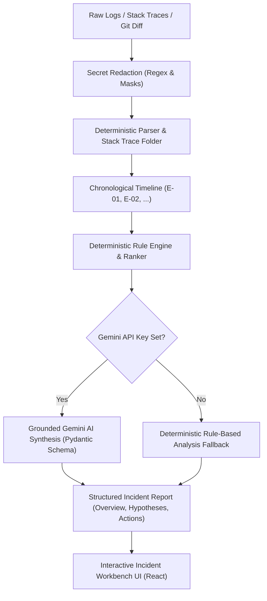

# Whyrus — AI Root-Cause Analysis Platform

> **“Understand the failure. Find the reason.”**  
> *From scattered errors to evidence-backed answers.*

Whyrus is a production-minded incident investigation and root-cause analysis (RCA) platform. It takes unstructured log dumps, stack traces, and optional Git diffs, redacts sensitive credentials, reconstructs the incident chronologically, and synthesizes explainable root-cause hypotheses with actionable verification checks.

---

## Core Product Principles

1. **Evidence Before Assumptions**: Hypotheses must point directly to observed Evidence IDs (`E-01`, `E-02`). No invented logs, files, or phantom stack frames.
2. **Correlation ≠ Causation**: Chronological precedence indicates likelihood, but alternative network or dependency failures are explicitly acknowledged.
3. **Calibrated Confidence**: Confidence scores and labels (*High*, *Moderate*, *Plausible*, *Preliminary*) reflect evidence strength and completeness.
4. **Transparent Uncertainty**: When logs are incomplete, Whyrus explicitly identifies the *missing evidence* needed before making irreversible changes.
5. **Practical Developer Next Steps**: Recommends targeted, categorized checks (immediate inspection, socket probes, code reviews) rather than generic troubleshooting advice.
6. **Built-in Privacy & Secret Scrubbing**: JWTs, Bearer headers, database passwords, and cloud API keys are scrubbed both client-side and on the backend before processing.

---

## Architecture Overview



### Components

- **Frontend (`/frontend`)**:
  - React 19 + Vite 6 + Tailwind CSS v4 + Lucide React.
  - Editorial, TCS-inspired presentation with confident headline hierarchy and deliberate whitespace.
  - Interactive incident reconstruction visualization in the hero.
  - Interactive product demonstration using the canonical database cascade log.
  - Dedicated `/analyze` incident workbench with file upload, live log editor, preset loaders, and interactive evidence linking.
- **Backend (`/backend`)**:
  - Python 3 + FastAPI + Pydantic v2.
  - `analyzer/redactor.py`: Detects and scrubs Bearer tokens, JWTs, DB passwords, and AWS credentials.
  - `analyzer/parser.py`: Deterministic log parsing with ISO/clock timestamp extraction and stack-trace folding.
  - `analyzer/git_diff.py`: Git diff parser correlating configuration keywords (`timeout`, `pool_size`, `port`) with errors.
  - `analyzer/ranker.py`: Rule-based cascade analyzer and hypothesis ranker.
  - `analyzer/ai_engine.py`: Evidence-grounded Google Gemini synthesis with deterministic fallback.
  - `main.py`: REST endpoints (`/api/health`, `/api/presets`, `/api/redact-preview`, `/api/analyze`).
  - `tests/`: Automated unit and API test suites.

---

## Getting Started

### 1. Prerequisites
- Python 3.10+ (System Python or virtualenv)
- Node.js 18+ and npm

### 2. Backend Setup
```bash
cd backend

# (Optional) Add your Google Gemini API key to backend/.env
# If left blank, Whyrus runs its comprehensive deterministic rule engine.
echo "GEMINI_API_KEY=your_key_here" > .env

# Run unit and API integration tests
python3 -m unittest discover tests

# Start FastAPI server (runs on http://127.0.0.1:8000)
python3 -m uvicorn main:app --host 127.0.0.1 --port 8000 --reload
```

### 3. Frontend Setup
```bash
cd frontend

# Install dependencies
npm install

# Start development server (runs on http://127.0.0.1:5173)
npm run dev

# Or build production assets
npm run build
```

---

## API Reference

### `GET /api/health`
Returns system status, active engine, and whether Gemini API credentials are configured.

### `GET /api/presets`
Returns curated, realistic failure scenarios:
- **Database Pool Exhaustion Cascade**
- **JVM Batch Heap Exhaustion (OOMKilled)**
- **Clock Skew & Auth Token Invalidation**

### `POST /api/redact-preview`
**Request:**
```json
{ "text": "Authorization: Bearer eyJhbGci... and pwd=secret" }
```
**Response:**
```json
{
  "original_length": 55,
  "redacted_text": "Authorization: Bearer [REDACTED_TOKEN] and pwd=[REDACTED_PASSWORD]",
  "redactions_count": 2
}
```

### `POST /api/analyze`
**Request:**
```json
{
  "raw_logs": "10:42:01 INFO [order-service] Starting service...\n10:42:04 ERROR [db-pool] Connection timeout\n10:42:06 ERROR [http-server] HTTP 500",
  "git_diff": "diff --git a/config/database.yml...",
  "service_context": "order-service",
  "use_ai": true
}
```

**Response:**
Returns a structured `AnalysisResult` schema containing `incident_id`, `overview`, `timeline` with Evidence IDs, `hypotheses` with confidence labels and missing evidence, and `recommended_actions`.

---

## Running Automated Tests

```bash
# Run all backend unit and API tests
python3 -m unittest backend/tests/test_analyzer.py
python3 -m unittest backend/tests/test_api.py
```
Expected output:
```
Ran 9 tests in 0.052s
OK
```

---

## Visual Design System & Palette

- **Deep Ink/Navy:** `#17243A`
- **Warm Off-White:** `#F7F6F2`
- **Pure White:** `#FFFFFF`
- **Muted Slate:** `#64748B`
- **Teal Accent:** `#167D78`
- **Soft Amber:** `#E5A34B`
- **Restrained Red for Errors:** `#C94C4C`
- **Headings:** Manrope
- **Body:** Inter
- **Code/Logs:** JetBrains Mono
